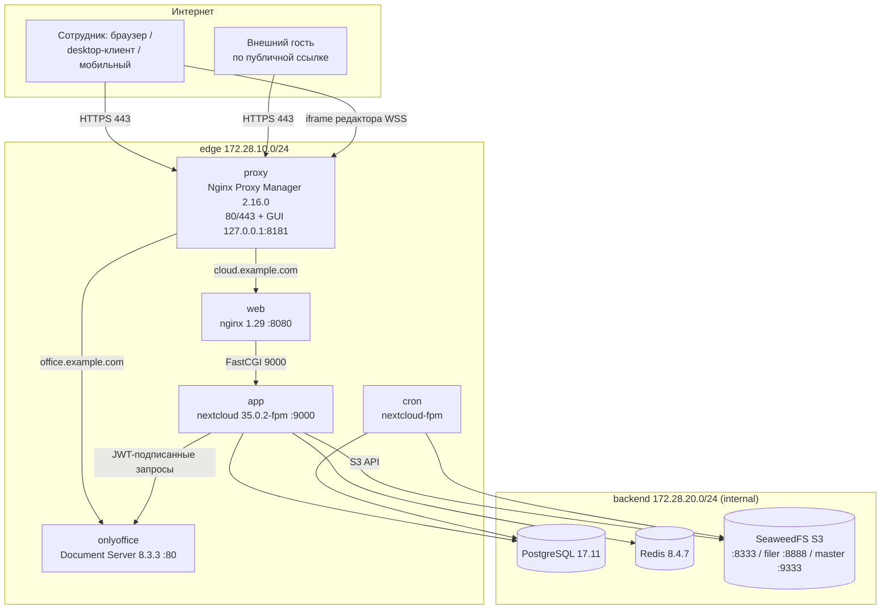
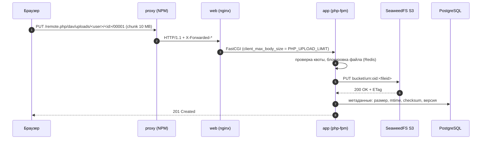
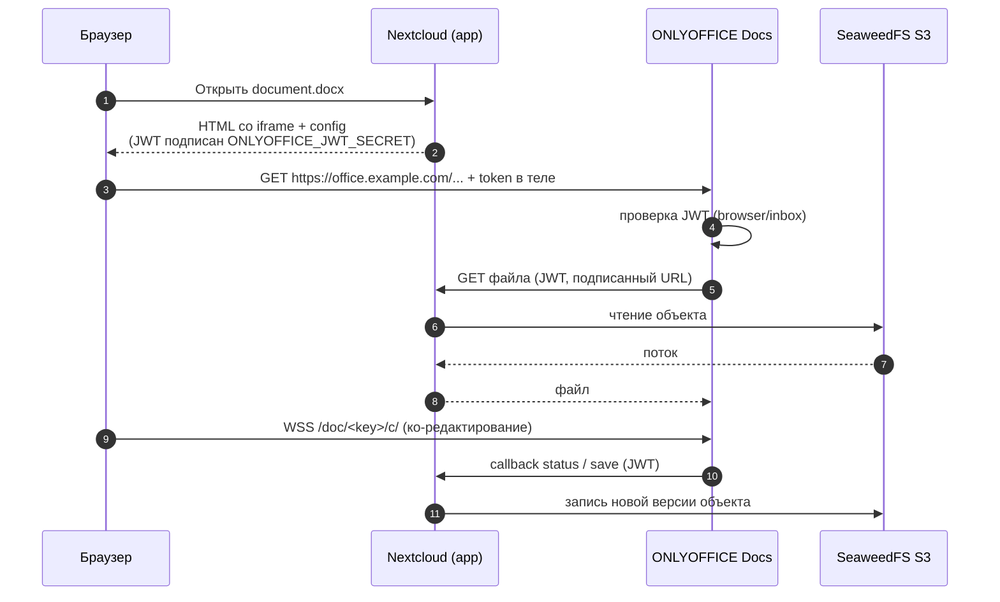

# 01. Архитектура

*Документ описывает целевую архитектуру Cloud Suite — корпоративной замены Яндекс.Диска
на собственном оборудовании. Все приведённые имена хостов, порты, сети и переменные
совпадают с реализацией в репозитории (см. [`../CONTRACT.md`]).*

## 1. Что разворачивается

Cloud Suite — это один Linux-VM с публичным IP, на котором всё работает через
`docker compose`:

| Слой | Компонент | Роль |
|---|---|---|
| Вход | Nginx Proxy Manager 2.16.0 | терминация TLS (Let's Encrypt), маршрутизация по двум доменам, HSTS, списки доступа к админ-панелям |
| Фронт | nginx 1.29-alpine (`web`) | отдача статики Nextcloud, PHP-FPM fastcgi, ограничения размера тела и таймауты, JSON-логи доступа |
| Приложение | Nextcloud 35.0.2 FPM (`app`) | файловый сервис: веб-интерфейс, WebDAV, OCS API, шаринг, версии, корзина |
| Фон | `cron` (тот же образ) | фоновые задачи Nextcloud каждые 300 с |
| Метаданные | PostgreSQL 17.11 | пользователи, группы, права, метаданные файлов, шары, версии, аудит |
| Кэш | Redis 8.4.7 | распределённые блокировки (Transaction locking), кэш, сессии |
| Объектное хранилище | SeaweedFS (S3 gateway) | **основное хранилище содержимого файлов** |
| Офис | ONLYOFFICE Docs 8.3.3 | просмотр и совместное редактирование DOCX/XLSX/PPTX/ODF в браузере |

## 2. Требования заказчика → реализация

| № | Требование | Как реализовано | Где |
|---|---|---|---|
| 1 | Хранение файлов в S3, а не в Яндекс.Диске | Nextcloud работает в режиме `objectstore` (S3 primary storage) на SeaweedFS S3 gateway; локальный диск ВМ хранит только БД, логи и служебные тома | `config/nextcloud/` |
| 2 | Веб-интерфейс | Nextcloud web UI + WebDAV/OCS для клиентов | `app`, `web` |
| 3 | Вход и авторизация через nginx с GUI-управлением | Nginx Proxy Manager: GUI на loopback-порту, два proxy host, Let's Encrypt, списки доступа | `config/proxy/` |
| 4 | Общие папки между сотрудниками | Группы Nextcloud + внутренние шары, политики в `config/rbac/` | [04-rbac-and-sharing.md](04-rbac-and-sharing.md) |
| 5 | Публичные ссылки «только чтение» и «с редактированием» | Link share с правами read / read+update, пароль и срок действия по политике | [04-rbac-and-sharing.md](04-rbac-and-sharing.md) |
| 6 | Настраиваемая ролевая модель | Группы + делегированные администраторы групп, декларативный `config/rbac/roles.yaml`, применение через `scripts/rbac-sync.sh` | [04-rbac-and-sharing.md](04-rbac-and-sharing.md) |
| 7 | Аудит действий пользователей | Приложение `admin_audit` → JSON-lines, плюс JSON-лог доступа nginx | [05-audit-logging.md](05-audit-logging.md) |
| 8 | До 20 версий файла (настраивается) | `files_versions` + почасовой/суточный прунер по количеству (`VERSIONS_MAX`) | [06-versioning-and-retention.md](06-versioning-and-retention.md) |
| 9 | Встроенный офис | ONLYOFFICE Docs 8.3.3 + коннектор Nextcloud, JWT-защита | [02-deployment.md](02-deployment.md) |
| 10 | Промышленная эксплуатация | healthcheck’и, пины версий, резервное копирование, DR-регламент, CI-валидация | [07-backup-restore-dr.md](07-backup-restore-dr.md), [09-operations-runbook.md](09-operations-runbook.md) |

**Жёсткое ограничение:** один сервер, один `docker compose`. Кубернетеса нет,
оркестрация — Compose, обновление — замена образов и `occ upgrade`.

## 3. Компоненты и их контракты

### 3.1 Сервисы compose

| Сервис | Образ (пин) | Сети | Публикуемые порты | Назначение |
|---|---|---|---|---|
| `proxy` | `jc21/nginx-proxy-manager:2.16.0` | edge `172.28.10.10` | `80:80`, `443:443`, `127.0.0.1:8181:81` | TLS, маршрутизация, GUI |
| `web` | `nginx:1.29-alpine` | edge | — | Nextcloud front controller, `:8080` |
| `app` | `nextcloud:35.0.2-fpm` | edge + backend | — | php-fpm `:9000` |
| `cron` | `nextcloud:35.0.2-fpm` | backend | — | `php -f cron.php` в цикле |
| `db` | `postgres:17.11-alpine` | backend | — | PostgreSQL |
| `cache` | `redis:8.4.7-alpine` | backend | — | блокировки и кэш |
| `s3` | `chrislusf/seaweedfs:${SEAWEEDFS_VERSION}` | backend | — | S3 gateway `:8333`, filer `:8888`, master `:9333` |
| `s3-init` | `chrislusf/seaweedfs:${SEAWEEDFS_VERSION}` | backend | — | one-shot: создаёт бакет `$S3_BUCKET` |
| `onlyoffice` | `onlyoffice/documentserver:8.3.3` | edge | — | Document Server, `:80` |

Публично опубликованы только порты `proxy`: 80/443 (и 81 на loopback).
Все остальные сервисы доступны только внутри docker-сетей — это осознанное решение,
а не недоделка.

### 3.2 Сети

| Сеть | Подсеть | `internal` | Кто в ней |
|---|---|---|---|
| `edge` | `172.28.10.0/24` | нет | `proxy` (закреплён на `.10`), `web`, `app`, `cron`, `onlyoffice` |
| `backend` | `172.28.20.0/24` | да | `db`, `cache`, `s3`, `app`, `cron` |

Фиксированные подсети нужны не для красоты:

* `TRUSTED_PROXIES=172.28.10.0/24` — Nextcloud доверяет `X-Forwarded-For`
  только из этой сети, поэтому клиентский IP в аудите и в защите от брутфорса —
  настоящий, а не `172.28.10.10`;
* `PROXY_IP=172.28.10.10` — закреплённый адрес NPM; `app` и `onlyoffice`
  получают `extra_hosts` с публичными именами, указывающими на этот адрес,
  чтобы серверные callback’и не выходили в интернет и не «зависали» на hairpin NAT;
* `backend` с `internal: true` — у БД, Redis и S3 физически нет
  маршрута в интернет: даже при компрометации PHP-контейнера выкачать данные
  напрямую с S3 наружу нельзя.

### 3.3 Кто куда ходит (разрешённые связи)

| Источник → приёмник | Протокол | Зачем |
|---|---|---|
| Internet → `proxy` | 80/443 | HTTPS-трафик, ACME HTTP-01 |
| `proxy` → `web` | HTTP :8080 | проксирование `$CLOUD_DOMAIN` |
| `proxy` → `onlyoffice` | HTTP :80 | проксирование `$OFFICE_DOMAIN` |
| `web` → `app` | FastCGI :9000 | PHP |
| `app` → `db` | PostgreSQL :5432 | метаданные |
| `app` → `cache` | Redis :6379 (AUTH) | блокировки, кэш |
| `app` → `s3` | S3 API :8333 | объекты файлов |
| `app` ↔ `onlyoffice` | HTTPS 443 + WSS | конфиг редактора, callback сохранения |
| Браузер ↔ `onlyoffice` | HTTPS/WSS | загрузка редактора, ко-редактирование |

Любая другая связь — повод для разбора инцидента, а не для «временного правила
в firewall».

## 4. Схема развёртывания



Обратите внимание: `web` — единственный компонент, который отдаёт статику из
`nextcloud_html`, причём том подключён **read-only**, а `/data` и
`/config` закрыты в nginx явными `deny`-правилами.

## 5. Потоки данных

### 5.1 Вход в веб-интерфейс

1. Браузер: `GET https://cloud.example.com/login`.
2. NPM принимает TLS (сертификат Let's Encrypt, TLS 1.2/1.3), добавляет
   `X-Forwarded-For`, `X-Forwarded-Proto: https`, `X-Forwarded-Host`,
   проксирует на `web:8080`.
3. `web` проверяет `Host` (неизвестный — `return 444`), отдаёт
   статику либо передаёт `/index.php` в `app:9000` по FastCGI.
4. `app` читает `config.php`, проверяет `trusted_domains` и
   `trusted_proxies`, аутентифицирует пользователя (пароль + TOTP, если включено),
   пишет событие `login` в audit-лог.
5. Ответ собирается `web`, NPM добавляет HSTS и security-заголовки, браузер
   получает HTML.

Проверка «настоящего» клиентского IP: `set_real_ip_from 172.28.10.0/24` в
`config/nginx/` + `trusted_proxies` в Nextcloud. Без этого в audit-логе
вместо адреса сотрудника был бы адрес NPM, а защита от подбора пароля блокировала
бы всех сразу.

### 5.2 Загрузка файла



Ключевые детали:

* **чанковая загрузка** (DAV uploads v2, чанки по 10 МБ) — большие файлы не
  упираются в таймаут, докачка возможна;
* `PHP_UPLOAD_LIMIT` (по умолчанию `10G`) должен совпадать в трёх местах:
  `client_max_body_size` у nginx, `upload_max_filesize`/`post_max_size` в
  PHP и лимит Nextcloud; рассинхрон даёт `413 Request Entity Too Large`;
* содержимое пишется **сразу в S3**, на диске ВМ объектов файлов нет —
  локальный том `s3_data` только у `s3`-контейнера;
* имена объектов — `urn:oid:<fileid>` (внутренняя нумерация Nextcloud), поэтому
  в бакете нет пользовательских путей, а переименование файла в UI не создаёт
  копию в S3.

### 5.3 Скачивание и публичные ссылки

`GET /s/<token>` → Nextcloud проверяет срок действия и пароль ссылки →
потоковая отдача объекта из S3 через PHP. Ссылка «только чтение» имеет права
`read`, ссылка «с редактированием» — `read + update` (см.
[04-rbac-and-sharing.md](04-rbac-and-sharing.md)). Публичная ссылка не даёт доступа
к остальному дереву файлов: права ограничены одним узлом.

### 5.4 Совместное редактирование (ONLYOFFICE)



Что важно понимать эксплуатации:

* Document Server **не имеет** прямого доступа к S3 и к БД — он получает файл по
  HTTPS от Nextcloud; именно поэтому `app` и `onlyoffice` получают
  `extra_hosts` на `172.28.10.10`, а не ходят через публичный DNS;
* JWT — единственный барьер между редактором и файлами. Секрет
  `ONLYOFFICE_JWT_SECRET` один и тот же в контейнере `onlyoffice` и в
  настройках коннектора Nextcloud; заголовок — `Authorization` (Bearer),
  токен также передаётся в теле (`ONLYOFFICE_JWT_IN_BODY=true`);
* ко-редактирование идёт по WebSocket (`wss://office.example.com`). NPM обязан
  пропускать `Upgrade`/`Connection` и держать таймаут 3600 с, иначе
  редактор «отваливается» через 60 секунд;
* сохранение — асинхронный callback; при ошибке «The document could not be saved»
  проверяют доступность `https://cloud.example.com` **из контейнера**
  `onlyoffice` (см. [11-troubleshooting.md](11-troubleshooting.md));
* файл не «блокируется» навсегда: блокировка ко-редактирования живёт в Redis и
  снимается при закрытии сессии; при падении DS остаётся последняя сохранённая
  версия.

### 5.5 Синхронизация desktop- и мобильных клиентов

Клиенты Nextcloud используют WebDAV (`/remote.php/dav/files/<user>/`) и OCS.
Для них работают те же ограничения и те же логи, что и для браузера. Синхронизация
идёт поверх HTTPS через NPM, отдельных портов открывать не нужно. Подробности для
пользователей — в [10-user-guide.md](10-user-guide.md).

### 5.6 Фоновые задачи

`cron` каждые `CRON_INTERVAL_SECONDS` (300 с) выполняет `cron.php`:
очистка корзины (`TRASH_RETENTION_DAYS`), удаление старых версий по
`VERSIONS_RETENTION_DAYS`, превью, уведомления, `files:scan` при
необходимости. Прунер по количеству (`VERSIONS_MAX`) запускается отдельной
задачей — см. [06-versioning-and-retention.md](06-versioning-and-retention.md).

## 6. Почему это аналог Яндекс.Диска, а не «просто шара»

| Возможность Яндекс.Диска | В Cloud Suite |
|---|---|
| Файлы в облаке, доступ откуда угодно | Nextcloud + S3, HTTPS |
| Веб-интерфейс с папками и превью | Nextcloud web UI |
| Синхронизация с ПК | Nextcloud Desktop (Windows/macOS/Linux) |
| Мобильные приложения | Nextcloud iOS/Android |
| Общий доступ коллегам | внутренние шары, права на папки |
| Публичная ссылка | link share: read-only или с редактированием, пароль, срок |
| Редактирование офисных документов в браузере | ONLYOFFICE Docs |
| История версий и корзина | `files_versions` (20 версий) и `files_trashbin` (30 дней) |
| Администрирование и аудит | группы/роли, `admin_audit`, JSON-логи nginx |

Отличия, о которых нужно сказать заказчику заранее:

* администратор — ваш, а не вендора: обновления, бэкапы и мониторинг на вашей стороне;
* «безлимита» нет — квоты задаются ролями (`config/rbac/roles.yaml`);
* нет встроенного антивируса и DLP «из коробки» — при необходимости это отдельные
  приложения/интеграции, в текущем объёме работ не поставлены;
* совместное редактирование требует, чтобы браузер пользователя мог достучаться
  до `office.example.com` — при жёстком корпоративном прокси это надо
  проверить до внедрения.

## 7. Почему SeaweedFS и насколько S3 сменяем

**Почему не MinIO.** Community-редакция MinIO фактически перестала публиковать
готовые образы и претерпела изменения в лицензировании/поддержке; для новой
инсталляции в 2026 году это риск: неясная судьба обновлений и отсутствие
предсказуемых тегов. Для проекта, который должен жить 5+ лет, это неприемлемо.

**Почему SeaweedFS.** Один контейнер даёт S3-совместимый шлюз (`weed s3`),
filer и master; хранит данные на локальном диске томами по
`SEAWEEDFS_VOLUME_SIZE_MB` (по умолчанию 30720 МБ = 30 ГиБ; **больше 30720 задавать
нельзя** — master завершается с ошибкой `master.volumeSizeLimitMB should not exceed 30720`); активно развивается;
поддерживает path-style (`S3_USE_PATH_STYLE=true`), что обязательно для Nextcloud.

**Насколько сменяем.** Nextcloud обращается к S3 по стандартному API: endpoint,
ключи, bucket, region, path-style. Замена SeaweedFS на MinIO/AWS S3/Ceph RGW —
это правка `config/nextcloud/` (hostname/port/use_ssl) и `.env`; поменять
придётся и создание бакета (вместо `s3-init` — `mc mb`/`aws s3 mb`).
Перенос уже накопленных объектов — отдельная процедура копирования бакета;
просто «переключить endpoint» на живых данных нельзя.

**Важное ограничение Nextcloud:** режим `objectstore` задаётся при создании
инсталляции. Если система уже работала на локальном диске, переход на S3 —
миграция (`occ files:transfer-ownership`/перенос через `rsync` + `files:scan`),
а не правка конфига. В этом проекте S3-primary включён с первого запуска.

## 8. Где что хранится

| Данные | Где физически | Том/путь | Резервируется |
|---|---|---|---|
| Содержимое файлов | объекты S3 | том `s3_data` | да (снапшот тома) |
| Метаданные, пользователи, шары, версии | PostgreSQL | том `db_data` | да (`pg_dump`) |
| Код Nextcloud, приложения | том `nextcloud_html` | `nextcloud_html` | нет (восстанавливается из образа), конфиги — из git |
| Локальный кэш/превью | `nextcloud_data` (локальный data-dir, но файлы в S3) | том | нет |
| Блокировки, кэш | Redis | том `redis_data` | нет (переживаем потерю) |
| Сертификаты и конфиг NPM | NPM | `proxy_data`, `proxy_letsencrypt` | да (иначе — перевыпуск LE) |
| Аудит | файл `logs/cloudsuite/audit.log` (bind-mount) | `logs/cloudsuite/` | да, отдельно от БД |
| Логи nginx / ONLYOFFICE | bind-mount и том | `logs/nginx/`, том `onlyoffice_logs` | по регламенту |
| Секреты | `.env` на хосте (600) | — | да, в зашифрованном бэкапе |

Разделение «содержимое в S3 / метаданные в БД / кэш в Redis» — ключевое для
резервного копирования: без дампа БД бакет S3 бесполезен (нет дерева файлов), а
без бакета дамп БД ссылается в пустоту. Оба компонента обязаны попадать в один
бэкап-сет — см. [07-backup-restore-dr.md](07-backup-restore-dr.md).

## 9. Масштабирование

Базовая топология — одна ВМ. Порядок масштабирования (каждый шаг — после
измерений, а не «на всякий случай»):

| Симптом | Что делать |
|---|---|
| CPU php-fpm в потолке, растёт latency | поднять `pm.max_children`/`PHP_MEMORY_LIMIT`, увеличить vCPU; включить OPcache (уже включён в образе) |
| Мало RAM на превью/редактирование | вынести `onlyoffice` на отдельную ВМ (DocumentServerUrl меняется на его домен), оставить JWT |
| Упирается диск под S3 | добавить volume-сервер SeaweedFS (несколько `weed volume` с общим master), либо переехать на Ceph RGW/AWS S3 |
| Много одновременных редакторов | несколько реплик Document Server за балансировщиком (требуется общий Redis для DS) |
| Тяжёлая БД | отдельная ВМ с PostgreSQL, `shared_buffers` 25 % RAM, регулярный `VACUUM` |
| Нужна отказоустойчивость | второй `app`-узел за NPM, общий S3/БД/Redis; Nextcloud допускает несколько app-серверов на одних данных |

Что **не** масштабируется просто: `cron` должен быть в единственном экземпляре
(иначе дубли задач); NPM — единственная точка входа, при потере ВМ сервис
недоступен (см. DR в [07-backup-restore-dr.md](07-backup-restore-dr.md)).

## 10. Домены отказа

| Отказ | Последствие | Восстановление |
|---|---|---|
| Упал `app` | 502 на всех страницах | `docker compose restart app` |
| Упал `web` | 502 от NPM | restart `web` |
| Упал `onlyoffice` | документы открываются, редактор — нет | restart `onlyoffice` |
| Упал `db` | 500/«Internal Server Error» | restart, при повреждении — restore |
| Упал `cache` | ошибки блокировок, «file is locked» | restart (кэш теряется без последствий) |
| Упал `s3` | 503 при скачивании/загрузке, метаданные целы | restart `s3` |
| Упал `proxy` | сайт недоступен целиком | restart; сертификаты в `proxy_letsencrypt` |
| Потеря ВМ | полная недоступность | restore по [07-backup-restore-dr.md](07-backup-restore-dr.md) |

## 11. Требования к ресурсам

Минимум для пилота и рекомендуемые значения:

| Профиль | vCPU | RAM | Диск | Комментарий |
|---|---|---|---|---|
| до 25 пользователей | 4 | 8 ГБ | 100 ГБ + данные | prod-минимум, OnlyOffice делит RAM с Nextcloud |
| 25–100 пользователей | 8 | 16 ГБ | 200 ГБ + данные | рекомендуемая конфигурация |
| 100–250 пользователей | 12 | 32 ГБ | 500 ГБ + данные | OnlyOffice на отдельную ВМ желательно |
| > 250 | 16+ | 64 ГБ | по расчёту | выносить БД и OnlyOffice, S3 — на несколько узлов |

Отдельно проверить перед стартом: `vm.max_map_count=262144` (нужен
OnlyOffice), `fs.inotify.max_user_watches` ≥ 524288, `ulimit -n` ≥ 65535,
часы синхронизированы (иначе плывут JWT-проверки и audit-время).

Расчёт диска под данные:

```text
диск ≈ (активные файлы) × 1.1
       + (файлы, изменявшиеся за 30 дней) × (VERSIONS_MAX / 2)   # версии
       + (удалённое за 30 дней) × 1.0                            # корзина
       + 20% на служебное (логи, БД, превью, tmp)
```

Пример: 2 ТБ активных файлов, 10 % файлов меняются в месяц, `VERSIONS_MAX=20` →
ориентировочно 2 ТБ + 0.2 ТБ версий + запас ≈ 2.8–3 ТБ сырых данных S3.

## 12. Принятые решения и их причины

| Решение | Альтернатива | Почему так |
|---|---|---|
| S3-primary (SeaweedFS) | локальный диск + NFS | требование «S3 вместо Яндекс.Диска», независимость от размера диска ВМ |
| NPM как единая точка входа | отдельный nginx + certbot + свой GUI | заказчик просил «nginx с GUI»; LE и access lists из коробки |
| onlyoffice в Docker, JWT | внешний облачный редактор | данные не покидают контур, требование по 152-ФЗ |
| Redis для locking | файловые блокировки | несколько PHP-воркеров и `cron` не конфликтуют |
| JSON-логи доступа | стандартный combined | разбор в jq/Loki без регэкспов |
| Один хост | кластер | бюджет и требования; архитектура готова к шагам масштабирования |

## 13. Связанные документы

* [02-deployment.md](02-deployment.md) — установка с нуля.
* [03-security-hardening.md](03-security-hardening.md) — модель угроз и хардненинг.
* [04-rbac-and-sharing.md](04-rbac-and-sharing.md) — роли и шаринг.
* [05-audit-logging.md](05-audit-logging.md) — аудит.
* [06-versioning-and-retention.md](06-versioning-and-retention.md) — версии и хранение.
* [07-backup-restore-dr.md](07-backup-restore-dr.md) — бэкапы и аварийное восстановление.
* [08-migration-from-yandex-disk.md](08-migration-from-yandex-disk.md) — миграция.
* [09-operations-runbook.md](09-operations-runbook.md) — эксплуатация.
* [10-user-guide.md](10-user-guide.md) — инструкция для сотрудников.
* [11-troubleshooting.md](11-troubleshooting.md) — диагностика.
* [12-acceptance-checklist.md](12-acceptance-checklist.md) — приёмка.

